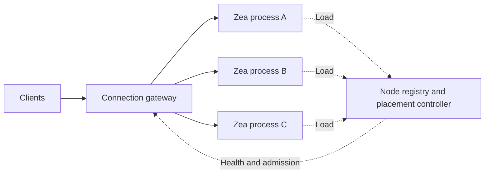

# Scaling Out Independent Zea Processes

This is a design proposal, not an implemented cluster feature. Start by measuring
one process with explicit CPU, memory, connection and latency budgets. The current
bounded JSON echo tests establish observed capacity points for their resource
envelope; they do not establish an unrestricted machine maximum. See
[process budgets](MULTI_PROCESS_TUNING.md) and [metrics](MONITORING.md).

## Current Ownership Boundary

The default application owns one `Game`, which owns one ordered business executor.
`SessionService` stores its credential-to-session registry in process memory.
Sessions retain their local channel, sender, handler registrations and dispatcher.
An independent process can serve another partition of traffic with its own state.

Prefer separate JVMs for these independent instances. Shared Session dispatchers,
their terminal lifecycle, and several metric owners are process-wide. Constructing
several contexts in one JVM does not provide independent lifecycle or monitoring
isolation. Increasing Session shards does not parallelize one Game's executor.

Only compatible instances of the same application and protocol belong in one
backend pool. If players share mutable Game state, route that whole Game to its
owning process. Dividing its players among unrelated in-memory Games changes
application behavior and requires explicit inter-process coordination.

## External Placement and Routing

A transport proxy can choose a backend for each new TCP connection and tunnel
WebSocket connections. For example, NGINX documents weighted connection routing,
least-connections selection and consistent hashing in its
[stream upstream module](https://nginx.org/en/docs/stream/ngx_stream_upstream_module.html),
and the required HTTP upgrade handling in its
[WebSocket guide](https://nginx.org/en/docs/http/websocket.html).
Envoy documents dynamic TCP routing on a
[per-connection basis](https://www.envoyproxy.io/docs/envoy/latest/configuration/listeners/network_filters/tcp_proxy_filter).
These features provide routing mechanisms; they do not transfer Zea's session or
Game state between nodes.

Select placement from application identity and workload, rather than source IP
alone. A generic transport proxy does not automatically understand a Game ID or
an account carried in a custom login frame. Application-aware placement needs a
trusted admission service, an explicit client discovery step, or a gateway that
understands the bounded login protocol.

Pin an accepted connection to its backend. Route subsequent joins or reconnects
for an existing Game through its authoritative ownership mapping. Allocate new
independent Games or accounts to healthy nodes with spare capacity. Adding a node
then creates space for new work without transferring live callbacks or channels.
If the application requires ownership lookup, changing a hash-ring membership
alone is insufficient: the hash can select a different node without moving the
existing state.

## Signals for Dynamic Placement

Use a control plane to sample each node and publish a bounded admission policy.
Existing `FlowControlMetrics.snapshot()` exposes Session/Game pending counts and
bytes, task rejection, queue wait/execution percentiles, aggregate socket bytes,
read pauses and write timeouts. Additional placement signals include message rate,
quota-relative CPU utilization, GC time, memory headroom and application response
P99. Executor timing histograms are not end-to-end response latency.

Do not treat the current `/health/ready` response as a capacity check: it does not
inspect Game/Session queue pressure. The legacy `cpu_load` field measures host CPU,
and legacy traffic counters require application instrumentation. A placement
exporter needs process/cgroup CPU sampling, message rates over a time window and
an explicit readiness/draining state; use the live `flow_control` data for queue
and socket pressure.

Connection count alone does not represent load: many idle players can cost less
than one active fan-out Game. Normalize queue and byte usage against each node's
configured budgets, and consider both message rate and application cost. Apply
cooldown and hysteresis to placement updates to avoid oscillation. Stale, unhealthy,
draining or saturated nodes must stop receiving new assignments. Local count/byte
admission and backpressure remain authoritative if controller information is late.

The gateway also needs bounded input/output buffering, overload rejection and its
own capacity measurement. It must propagate pressure rather than hide backend
backpressure behind an unbounded forwarding queue.

## Capabilities Needed Before Stateful Clustering

| Capability | Current implementation | Required extension |
| --- | --- | --- |
| Node identity | IDs use a process-local atomic sequence; `generateFor()` ignores `ZeaNode` | Globally unique external node/session/Game keys; qualify local IDs by node identity |
| Node registration | No distributed registry | Heartbeats, expiry, readiness and capacity metadata |
| Ownership | Local Game and credential registry | Authoritative Game/account-to-node mapping when state must survive reconnect or duplicate login |
| Authentication | Default token service uses a private instance key | Compatible application authentication across nodes; persistent shared key through the existing environment setting or an application-managed verifier/token service |
| Duplicate login | Replaces sessions within one local registry | Cluster-wide ownership arbitration and fencing if one account must have only one active owner |
| Draining | Context closure disconnects and releases owned resources | Stop new placements, wait for application work to drain, then close; do not equate immediate closure with draining |
| Node failure | Live Game state is in process memory | Explicit reconnect, persistence/recovery or replicated state policy; load balancing alone cannot recover lost state |
| Live migration | No state transfer protocol | Freeze/admission boundary, state snapshot, owner epoch, ordered handover and reconnect/replay semantics |

Provision shared authentication material through the existing
`security.token.key.environment` mechanism or injected services. Sharing a token
key permits compatible verification; it does not share sessions, application
authorization or revocation policy. Keep secrets outside tracked configuration.
Coordinate node clocks for token expiry; sharing a key does not compensate for
inconsistent clocks. Ownership leases also need a defined time and fencing model.

First implement admission of new work, sticky ownership, node health and draining.
Add inter-node messaging only for application operations that cross ownership
boundaries. Live migration should be a separate feature with failure and ordering
tests; it is not necessary for an initial placement layer.

## Capacity Interpretation

Report P99 <= 100 ms and P99 <= 200 ms independently for each protocol, payload,
connection count and CPU allowance. A windowed client slows its sending when
responses slow down. Its largest passing throughput is an observed capacity point,
not proof that an arbitrary fixed arrival rate meets that latency target.
Use repeated measurements and separate load-generator accounting. Explicitly mark
a frontier that has not been bracketed, and distinguish a configured connection
cap from an experimentally sustained connection count.

More processes share a host's finite CPU and memory budget. Additional machines
can add capacity if independent Game/account partitions exist; one indivisible
serial Game still needs its own capacity plan. Do not multiply a single-process
echo throughput by the process count to promise aggregate business throughput.
